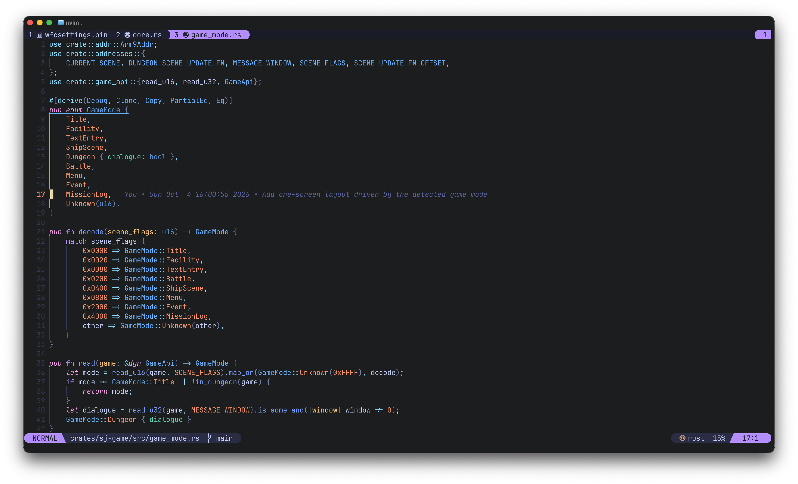

# Beubeu's Neovim Config

Personal Neovim configuration derived from [kickstart.nvim](https://github.com/nvim-lua/kickstart.nvim), targeting web development (TypeScript/JavaScript), PHP/Laravel and Ruby on Rails.



## Installation

### Prerequisites

- Neovim 0.11 or newer
- Git
- A [Nerd Font](https://www.nerdfonts.com/) installed and selected in your terminal (icons in the tabline/statusline)
- `ripgrep` (Telescope live grep)
- `lazygit` (for `<leader>gg`)
- `tree-sitter-cli` (`brew install tree-sitter-cli`) if you need to install missing Treesitter parsers

### Setup

1. Clone the repo into your Neovim config folder
   ```bash
   git clone <repo> ~/.config/nvim
   ```
2. Launch Neovim — lazy.nvim bootstraps itself and installs plugins on first run
   ```bash
   nvim
   ```
3. Check plugin and LSP health
   ```vim
   :Lazy
   :Mason
   ```

## Structure

```
init.lua                 leader + requires
lua/config/
  options.lua            editor options
  keymaps.lua            general keymaps
  autocmds.lua           yank highlight, Treesitter start
  lazy.lua               lazy.nvim bootstrap
  test_runners.lua       RSpec / Pest runners
lua/plugins/             one lazy.nvim spec per file, auto-imported
```

## Key points

- **Leader**: `<Space>`
- **Default colorscheme**: `tokyonight` (transparency enabled on startup)
- **LSP**: `ts_ls` (TypeScript/JS), `lua_ls` (Lua), `ruby_lsp` (Ruby/Rails), `intelephense` via laravel.nvim (PHP/Laravel) — managed by Mason
- **Formatting**: prettier via none-ls (project-local `node_modules/.bin` binaries, falling back to global). JS/TS/JSX/TSX are excluded from format-on-save; CSS/HTML/JSON/YAML/Markdown/SCSS/GraphQL are formatted on save. Manual format: `<leader>f`
- **Diagnostics**: PHPStan/Larastan via none-ls, with `intelephense` noise filtered on Pest tests

## Plugins

| Category | Plugins |
| --- | --- |
| Core | [lazy.nvim](https://github.com/folke/lazy.nvim), [which-key.nvim](https://github.com/folke/which-key.nvim), [vim-sleuth](https://github.com/tpope/vim-sleuth), [plenary.nvim](https://github.com/nvim-lua/plenary.nvim) |
| UI | [lualine.nvim](https://github.com/nvim-lualine/lualine.nvim), [indent-blankline.nvim](https://github.com/lukas-reineke/indent-blankline.nvim), [fidget.nvim](https://github.com/j-hui/fidget.nvim), [transparent.nvim](https://github.com/xiyaowong/transparent.nvim), [nvim-colorizer.lua](https://github.com/catgoose/nvim-colorizer.lua), [trouble.nvim](https://github.com/folke/trouble.nvim) |
| Navigation | [telescope.nvim](https://github.com/nvim-telescope/telescope.nvim) + [fzf-native](https://github.com/nvim-telescope/telescope-fzf-native.nvim), [oil.nvim](https://github.com/stevearc/oil.nvim), [nvim-tree.lua](https://github.com/nvim-tree/nvim-tree.lua) |
| Editing | [nvim-treesitter](https://github.com/nvim-treesitter/nvim-treesitter) + [textobjects](https://github.com/nvim-treesitter/nvim-treesitter-textobjects), [Comment.nvim](https://github.com/numToStr/Comment.nvim), [nvim-autopairs](https://github.com/windwp/nvim-autopairs) |
| LSP & completion | [nvim-lspconfig](https://github.com/neovim/nvim-lspconfig), [mason.nvim](https://github.com/williamboman/mason.nvim), [mason-lspconfig.nvim](https://github.com/williamboman/mason-lspconfig.nvim), [nvim-cmp](https://github.com/hrsh7th/nvim-cmp), [LuaSnip](https://github.com/L3MON4D3/LuaSnip) |
| Formatting & linting | [none-ls.nvim](https://github.com/nvimtools/none-ls.nvim), [none-ls-extras.nvim](https://github.com/nvimtools/none-ls-extras.nvim) |
| Git | [gitsigns.nvim](https://github.com/lewis6991/gitsigns.nvim), [git-blame.nvim](https://github.com/f-person/git-blame.nvim), [vim-fugitive](https://github.com/tpope/vim-fugitive), [vim-rhubarb](https://github.com/tpope/vim-rhubarb) |
| Terminal | [toggleterm.nvim](https://github.com/akinsho/toggleterm.nvim) |
| Laravel | [laravel.nvim](https://github.com/adalessa/laravel.nvim) |
| Rails | [vim-rails](https://github.com/tpope/vim-rails), [ruby-lsp](https://github.com/Shopify/ruby-lsp) + [ruby-lsp-rails](https://github.com/Shopify/ruby-lsp-rails) |

## Colorschemes

Installed: [tokyonight](https://github.com/folke/tokyonight.nvim) (default), [gruvbox](https://github.com/ellisonleao/gruvbox.nvim), [ayu](https://github.com/Shatur/neovim-ayu), [onedark](https://github.com/navarasu/onedark.nvim), [dracula](https://github.com/Mofiqul/dracula.nvim), [vscode](https://github.com/Mofiqul/vscode.nvim), [darcula](https://github.com/doums/darcula), [rose-pine](https://github.com/rose-pine/neovim), [catppuccin](https://github.com/catppuccin/nvim), [aura](https://github.com/baliestri/aura-theme).

- Try one for the session: `:colorscheme gruvbox`, or `:Telescope colorscheme` to preview them live
- Change the default: edit the tokyonight spec in `lua/plugins/colorschemes.lua`
- Toggle transparency: `:TransparentToggle`

The lualine theme pulls its colors from the active colorscheme, so the bubbles follow whatever theme is loaded.

## Key mappings

### Search (Telescope)

| Key | Action |
| --- | --- |
| `<leader>sf` | Search files |
| `<leader>sg` | Grep across the project |
| `<leader>sG` | Literal grep (special characters) |
| `<leader>sw` | Search word under cursor |
| `<leader>sh` | Search help tags |
| `<leader>sd` | List diagnostics |
| `<leader><space>` | Open buffers |
| `<leader>/` | Fuzzy search in current buffer |
| `<leader>?` | Recently opened files |

### Files

| Key | Action |
| --- | --- |
| `-` | Open parent directory (Oil) |
| `<leader>ff` | Open Oil |
| `<leader>fb` | Toggle NvimTree |
| `<leader>yp` | Yank relative file path |
| `<leader>yl` | Yank relative path with line number |

### LSP & diagnostics

| Key | Action |
| --- | --- |
| `gd` | Go to definition |
| `gD` | Go to declaration |
| `gr` | References (Telescope) |
| `gI` | Go to implementation |
| `<leader>D` | Type definition |
| `K` | Hover documentation |
| `<C-k>` (insert) | Signature help |
| `<leader>rn` | Rename symbol |
| `<leader>ca` | Code action |
| `<leader>ds` | Document symbols |
| `<leader>ws` | Workspace symbols |
| `[d` / `]d` | Previous / next diagnostic |
| `<leader>e` | Open floating diagnostic |
| `<leader>q` | Diagnostics list (loclist) |

### Git

| Key | Action |
| --- | --- |
| `<leader>gg` | Lazygit (floating terminal) |
| `<leader>hs` / `<leader>hr` | Stage / reset hunk |
| `<leader>hp` | Preview hunk |
| `<leader>hb` | Blame current line |
| `<leader>hd` | Diff current file |
| `]c` / `[c` | Navigate between hunks |

### Laravel

| Key | Action |
| --- | --- |
| `<leader>ll` | Laravel picker |
| `<leader>la` | Artisan picker |
| `<leader>lr` | Routes picker |
| `<leader>lm` | Make picker |
| `<leader>lc` | Commands picker |
| `<leader>lo` | Resources picker |
| `<c-g>` | View finder |

Laravel mappings only load in projects with an `artisan` file at the root.

### Rails

vim-rails only loads in projects with a `bin/rails` file at the root.

| Command | Action |
| --- | --- |
| `:A` / `:R` | Alternate (spec) / related (view, migration) file |
| `gf` | Jump to partial, association, route helper under cursor |
| `:Emodel`, `:Econtroller`, `:Eview`, … | Open a Rails file by name, with completion |
| `:Generate` / `:Destroy` | `rails generate` / `rails destroy` |
| `:Rails <task>` | Run a rails command or rake task |

For Rails-aware LSP features (routes, associations, schema on hover), add `ruby-lsp-rails` to the project's Gemfile development group.

### Tests

| Key | Action |
| --- | --- |
| `<leader>rf` | Run current RSpec file |
| `<leader>rl` | Run current RSpec line |
| `<leader>rp` | Run Pest tests (`php artisan test`) |

### Misc

| Key | Action |
| --- | --- |
| `<leader>t` | Floating terminal |
| `<C-h/j/k/l>` | Move between windows |
| `<leader>z` | Toggle colorizer |
| `<leader>xa` / `<leader>xA` | Swap parameter with next / previous |
| `<Tab>` / `<S-Tab>` | Next / previous buffer |
| `<C-n>` / `<C-p>` | Next / previous tab |

## Customization

Add a plugin by dropping a file in `lua/plugins/` that returns a lazy.nvim spec:

```lua
return {
  'author/plugin.nvim',
  opts = {},
}
```

It's picked up automatically on next launch. Run `:Lazy sync` to install it.

## Troubleshooting

- **`:TSInstall` fails** — the Treesitter `main` branch compiles parsers with the CLI: `brew install tree-sitter-cli`
- **JS/TS formatting or linting does nothing** — none-ls needs `prettier`/`eslint` resolvable, either in the project's `node_modules/.bin` or globally
- **Icons show as boxes or question marks** — your terminal isn't using a Nerd Font
- **Something else is off** — `:checkhealth`, `:Lazy`, `:Mason`, `:LspInfo`
